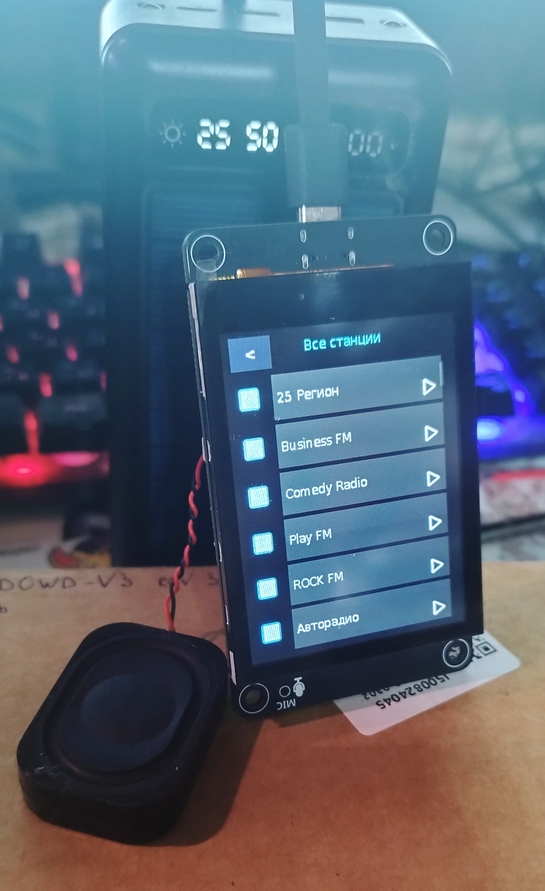
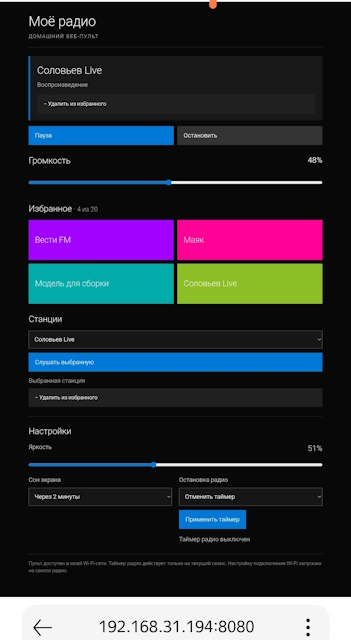
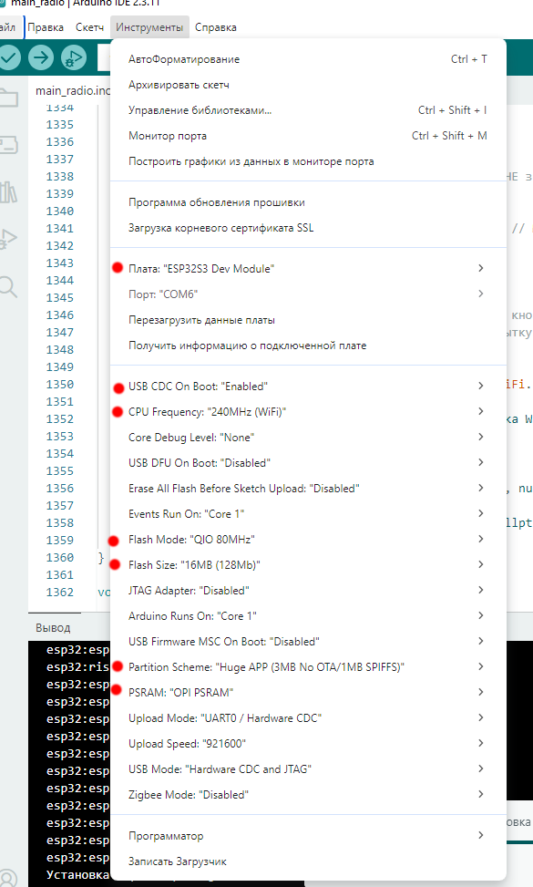

# Моё интернет-радио на ESP32-S3

**Автор и разработчик:** Борисенко Д.А.  
**г. Краснодон, ЛНР, 2026 год.**

Я разрабатываю интернет-радио с сенсорным управлением на плате LCDWiki ES3C28P. Радиостанции воспроизводятся через Wi-Fi, а экран позволяет выбирать станции, управлять громкостью, слушать MP3 с SD-карты и менять настройки без компьютера.

Проект задуман как цельное устройство, а не демонстрация отдельных библиотек. Интерфейс выполнен в стиле Metro — крупные цветные плитки, чёткие пиксельные значки, без сглаживания и зависимости от глифов шрифта. Звук и графика работают на разных ядрах ESP32-S3, поэтому пролистывание списка станций не прерывает эфир, а обрыв потока не замораживает экран.

    

Настройки сборки в Arduino IDE:

## Содержание

- [Возможности](#возможности)
- [Оборудование](#оборудование)
- [Используемые соединения встроенных узлов](#используемые-соединения-встроенных-узлов)
- [Среда разработки и настройки платы](#среда-разработки-и-настройки-платы)
- [Библиотеки и зависимости](#библиотеки-и-зависимости)
- [Архитектура программы](#архитектура-программы)
- [Экраны](#экраны)
- [Файлы программы](#файлы-программы)
- [Управление](#управление)
- [Аудиотракт и громкость](#аудиотракт-и-громкость)
- [Спектр и индикатор буфера](#спектр-и-индикатор-буфера)
- [Память и производительность](#память-и-производительность)
- [Список станций](#список-станций)
- [Особенности реализации](#особенности-реализации)
- [Ограничения и безопасность](#ограничения-и-безопасность)

## Возможности

**Радио и эфир**
- Прослушивание интернет-радиостанций из встроенного списка (63 станции).
- До 20 станций в избранном; хранение по URL в NVS, порядок списка не влияет на избранное.
- Автоматическое переподключение при обрыве потока с увеличивающейся задержкой (до 30 с).
- Раздельное определение «соединение установлено» и «идёт декодирование аудио»: интерфейс не показывает воспроизведение, пока не получен первый декодированный блок.
- Таймер остановки радио на текущий сеанс: 15, 30, 60 или 90 минут.
- Часы московского времени (UTC+3); до синхронизации с NTP показываю `--:--`.

**MP3 с SD-карты**
- Воспроизведение MP3-файлов с карты в режиме SD_MMC 1-bit (только три пина: CLK, CMD, DATA0).
- До 2000 файлов в плейлисте, natural sort с кириллицей, рекурсивный обход папок до 16 уровней.
- Плейлист сохраняется в файле `.radio-playlist.txt` в корне карты; есть резервная копия `.bak`.
- Закладка позиции в файле `.saved-state` — при паузе или остановке запоминается секунда воспроизведения, размер файла и признак паузы; при следующем включении радио возвращается к тому же треку.
- Перемотка касанием по прогресс-бару, постраничная навигация (по 30 строк), меню управления плейлистом: выбрать папку, добавить к текущему плейлисту, очистить, загрузить всю музыку с карты.

**Интерфейс**
- Сенсорный интерфейс в стиле Metro, поддержка кириллицы, свайпы между экранами (Главный ⇄ MP3 ⇄ Настройки, свайп вправо на главном → локальный Wi-Fi).
- Всплывающая регулировка громкости по кнопке в правом верхнем углу (автозакрытие через 3 с).
- Спектроанализатор на 8 полос (алгоритм Goertzel, окно 256 кадров) и индикатор заполнения входного буфера библиотеки.
- Пиксельная заставка при запуске — перспективное кольцо с вращением и надписью «Радио», 10 секунд.
- Сон дисплея без остановки радио; пробуждение касанием с подавлением первого нажатия, чтобы не сработала случайная кнопка.

**Настройки и сеть**
- Регулировка и сохранение громкости (шкала 0–21, линейная по амплитуде через `sqrt`), яркости (15–100 %).
- Локальный экран настройки Wi-Fi: поиск сетей, ввод пароля прямо на экране, сохранение в NVS — без блокирующего captive-портала.
- Веб-пульт на порту 8080: статус, избранное, станции, MP3-плеер, настройки; страница хранится в прошивке, интернет для её загрузки не требуется.
- Индикатор Wi-Fi и приблизительный индикатор заряда батареи по GPIO9 (делитель 1:2).
- Окно информации об авторе с адресом веб-пульта.

## Оборудование

| Узел | Что использую |
| --- | --- |
| Основная плата | LCDWiki ES3C28P на ESP32-S3 |
| Дисплей | Встроенный ILI9341V, 240 × 320 пикселей |
| Сенсор | Встроенный FT6336G |
| Аудиокодек | Встроенный ES8311 |
| Усилитель динамика | Встроенный FM8002E |
| Динамик | Пассивный, 8 Ом, подключённый к выходу SPK |
| Карта памяти | MicroSD (формат FAT32, режим SD_MMC 1-bit) |
| Питание | USB, 5 В, исправный кабель и стабильный источник |
| Сеть | Wi-Fi 2,4 ГГц с доступом в интернет |
| Память | Требуется работающая PSRAM для интерфейса и аудио |

Это программа для конкретной платы, а не универсальная прошивка для любых ESP32-S3. На другой плате могут отличаться экран, сенсор, аудиотракт и распиновка.

### Используемые соединения встроенных узлов

| Узел | GPIO |
| --- | --- |
| Дисплей: MOSI / MISO / SCLK | 11 / 13 / 12 |
| Дисплей: CS / DC / подсветка | 10 / 46 / 45 |
| I²C: SDA / SCL | 16 / 15 |
| Сенсор: Reset / Interrupt | 18 / 17 |
| Аудио: MCLK / BCLK / LRCK | 4 / 5 / 7 |
| Аудио: DOUT / DIN | 6 / 8 |
| Управление усилителем | 1 |
| SD-карта: CLK / CMD / DATA0 | 38 / 40 / 39 |

Эти соединения уже выполнены на плате. Дополнительные провода к встроенному дисплею, сенсору, кодеку и SD-слоту не требуются.

## Среда разработки и настройки платы

Проект собирается в **Arduino IDE 2.3.11**. Для корректной работы LVGL, PSRAM и аудио необходимо выставить следующие параметры в меню «Инструменты»:

| Параметр | Значение |
| --- | --- |
| Плата | ESP32S3 Dev Module |
| USB CDC On Boot | Enabled |
| CPU Frequency | 240MHz (WiFi) |
| Core Debug Level | None |
| Flash Mode | QIO 80MHz |
| **Flash Size** | **16MB (128Mb)** |
| **Partition Scheme** | **Huge APP (3MB No OTA/1MB SPIFFS)** |
| **PSRAM** | **OPI PSRAM** |
| Arduino Runs On | Core 1 |
| Events Run On | Core 1 |
| Upload Mode | UART0 / Hardware CDC |
| Upload Speed | 921600 |
| USB Mode | Hardware CDC and JTAG |

Таблица разделов `huge_app` даёт 3 МБ под прошивку — этого хватает для основного скетча, шрифтов, веб-страницы пульта и закреплённой версии ESP32-audioI2S.

## Библиотеки и зависимости

Я сохраняю версии библиотек: обновление может изменить интерфейс или поведение программы.

| Библиотека | Версия / примечание | Назначение |
| --- | --- | --- |
| [LovyanGFX](https://github.com/lovyan03/LovyanGFX) | 1.3.0 | Управление дисплеем и передача изображения |
| [LVGL](https://github.com/lvgl/lvgl) | 9.6.0 | Экраны, плитки, надписи, кнопки, ползунки |
| [ESP32-audioI2S](https://github.com/schreibfaul1/ESP32-audioI2S) | Закреплённый коммит | Получение и декодирование аудиопотока, вывод по I²S |
| [WiFiManager](https://github.com/tzapu/WiFiManager) | 2.0.17 | Резервный портал настройки Wi-Fi (используется только как fallback) |
| SD_MMC, LittleFS, Preferences, Wire, WiFi | Входят в Arduino Core для ESP32 | Работа с SD, flash-памятью, I²C и сетью |

Для ESP32-audioI2S закреплён конкретный коммит, а не номер релиза. Произвольная последняя версия не является точной заменой.

## Архитектура программы

Программа построена на двух задачах FreeRTOS, разделённых по ядрам, с обменом через очереди, мьютексы и атомарные переменные.

**Аудиозадача (`audio_task`, ядро 0, стек 20 КБ, приоритет 2)**
- Владеет объектом `Audio` библиотеки ESP32-audioI2S.
- Обрабатывает команды из GUI (выбор станции, пауза, громкость, тестовый тон).
- Отвечает за повторные подключения, таймер остановки радио, сохранение закладки SD-плеера.
- Вызывает `audio.loop()` в своём цикле; между вызовами собирает данные для спектра и индикатора буфера.
- Не обращается к LVGL и не рисует на экране.

**GUI-задача (`gui_task`, ядро 1, стек 12 КБ, приоритет 5)**
- Инициализирует LVGL, создаёт все экраны, опрашивает сенсор FT6336G.
- Принимает статусы и метаданные из аудиозадачи через очередь `uiEventQueue`.
- Обслуживает свайпы, сон дисплея, всплывающую громкость, локальный Wi-Fi UI.
- Не обращается к объекту `Audio` и не открывает сетевые соединения.

**Веб-сервер (ядро 1, приоритет 1, стек 8 КБ)**
- HTTP-сервер ESP-IDF на порту 8080.
- Отдаёт страницу пульта из прошивки, обрабатывает `/api/state`, `/api/control`, `/api/mp3`.
- Не вызывает Audio, LVGL или Preferences напрямую; команды отправляет в очередь `audioCmdQueue` или `remoteSettingsQueue`.

**Обмен между задачами**
- `audioCmdQueue` — команды GUI и веб-пульта в аудиозадачу (длина 12).
- `uiEventQueue` — статусы и метаданные из аудиозадачи в GUI (длина 1, overwrite).
- `remoteSettingsQueue` — настройки яркости, сна, таймера и избранного из веб-пульта.
- Атомарные переменные (`std::atomic`) — громкость, яркость, выбор сна, уровни спектра, заполнение буфера, флаги SD-плеера.
- `portMUX_TYPE` — критические секции для копирования строк метаданных и веб-статуса.
- `WireGuard` — RAII-обёртка над мьютексом I²C, защищает общую шину от одновременного обращения сенсора и кодека.

## Экраны

**Главный экран** — плитки избранного (2 колонки, до 10 строк с прокруткой), строка «Сейчас играет» с кнопкой Пауза/Продолжить, 8-полосный спектроанализатор, индикатор заполнения буфера, часы, значки Wi-Fi и батареи, кнопки «Станции» и «Настройки».

**Список станций** — прокручиваемый список всех 63 станций; в каждой строке чекбокс избранного и кнопка запуска. Чекбокс и кнопка — соседние объекты, управление избранным не запускает станцию.

**Настройки** — ползунки громкости, яркости, сна экрана, таймера радио; кнопка «Настройка Wi-Fi»; кнопка-шестерёнка открывает окно автора с адресом веб-пульта.

**MP3-плеер** — список файлов с карты, прогресс-бар с перемоткой касанием, кнопки управления (предыдущий/пуск/пауза/стоп/следующий), кнопка-папка открывает меню управления плейлистом.

**Локальный Wi-Fi** — список найденных сетей, экран ввода пароля с экранной клавиатурой, сохранение сети в NVS после успешного подключения.

**Всплывающая громкость** — полупрозрачная панель поверх любого экрана, автозакрытие через 3 с бездействия.

**Заставка** — 3D-кольцо с перспективной проекцией и надписью «Радио», 10 секунд при первом запуске.

## Файлы программы

Проект имеет плоскую структуру — все файлы в одной папке `main_radio`:

| Файл | Назначение |
| --- | --- |
| `main_radio.ino` | Основная программа: оборудование, аудио, интерфейс, сеть и настройки |
| `stations.h` | Список названий и адресов радиостанций (63 станции) |
| `sd_player_ui.h` | Интерфейс и логика MP3-плеера с SD-карты |
| `spectrum_analysis.h` | Спектроанализатор на 8 полос (Goertzel) |
| `web_remote.h` | Веб-пульт (HTTP-сервер на порту 8080) |
| `wifi_local_ui.h` | Локальный экран поиска и подключения к Wi-Fi |
| `audio_pinout.h` | Подбор совместимой сигнатуры настройки аудиовыводов при компиляции |
| `audio_stream_probe.h` | Механизм чтения приватных полей аудиобиблиотеки без её модификации |
| `lv_conf.h` | Конфигурация LVGL (RGB565, пул 512 КиБ в PSRAM) |
| `dejavu_16.c` | Рабочий шрифт 12px с кириллицей |
| `wifi_ui_font.c` | Шрифт для экрана локального Wi-Fi (с иконками) |
| `now_playing_data.h` | Заглушка для совместимости со старыми копиями проекта |
| `readme.md` | Этот документ |
| `img1.jpg` ... `img5.jpg` | Скриншоты интерфейса и веб-пульта |
| `Setting-Arduino_IDE-Compilation.png` | Скриншот настроек Arduino IDE |

Для приложения используется таблица разделов `huge_app`. Настройки памяти и LVGL должны оставаться согласованными с кодом.

## Управление

### Первый запуск
1. Подключаю динамик к SPK, вставляю SD-карту (FAT32) и подаю питание через USB.
2. Настраиваю Wi-Fi через встроенный экран «Настройка Wi-Fi» (кнопка-шестерёнка на главном экране или свайп вправо).
3. Выбираю станцию и устанавливаю удобную громкость.
4. После сохранения настроек программа использует сохранённую сеть, громкость и последнюю станцию.

### Навигация и жесты
- **Свайп влево** на главном экране → экран MP3-плеера.
- **Свайп влево** на экране MP3 → экран Настроек.
- **Свайп вправо** на экране Настроек → экран MP3.
- **Свайп вправо** на главном экране → локальный экран настройки Wi-Fi.
- **Нажатие на плитку** избранного или кнопку Play в списке → запуск станции.
- **Нажатие на строку «Сейчас играет»** → Пауза / Продолжить.
- **Кнопка-динамик** в правом верхнем углу → всплывающий ползунок громкости.

### Станции и избранное
Кнопка «Станции» открывает список. Нажатие на название или значок запуска выбирает станцию. Чекбокс только добавляет или удаляет её из избранного: не запускает воспроизведение и не закрывает список.
В избранном сохраняю до 20 станций. На плитке проигрываемой станции показываю значок Pause; при паузе значок исчезает.

### SD-плеер
На экране MP3 отображается список файлов с карты. Поддерживается постраничная навигация, перемотка касанием по прогресс-бару, сохранение позиции при паузе и остановке. Кнопка-папка открывает меню управления плейлистом: выбрать папку, добавить папку к текущему плейлисту, очистить плейлист или загрузить всю музыку с карты. Плейлист сохраняется в файле `.radio-playlist.txt` в корне карты.

### Настройки
Громкость располагается над яркостью. Выбранный уровень громкости сохраняю и повторно применяю после переключения станции. Разные станции могут иметь разный исходный уровень записи.
Сон дисплея и таймер остановки радио — разные функции: сон выключает подсветку, но оставляет звук; таймер останавливает воспроизведение. Значок информации (ⓘ) открывает сведения об авторе и адрес веб-пульта, не останавливая радио.

### Веб-пульт
После подключения радио к Wi-Fi открываю настройки и окно ⓘ: там показан адрес `http://адрес-платы:8080`. Телефон или компьютер подключаю к той же сети. Страница на русском хранится в прошивке, интернет для её загрузки не требуется.
Доступны: статус, станции, пуск/пауза, остановка, громкость, избранное, MP3-плеер (список файлов, перемотка), настройки яркости, сна экрана и таймера радио.
HTTP работает в отдельной задаче ESP-IDF; новых библиотек не добавляю. Порт 8080 не конфликтует с портом 80 настройки Wi-Fi. Пульт без пароля: пользуюсь только доверенной домашней сетью и не пробрасываю порт в интернет. Любой участник этой сети может управлять радио.

## Аудиотракт и громкость

**Кодек ES8311** инициализируется двумя таблицами регистров с выверенными задержками. Порядок записей и значения сохранены без изменений — это рабочая настройка звукового тракта, а не оформление интерфейса.

**Усилитель FM8002E** — мостовой, выход SPK. Ни один контакт динамика не соединяю с GND, выходы динамика не подключаю напрямую к AUX или RCA.

**Громкость** — внутренняя шкала библиотеки 0–255 квадратична. Компенсирую это через `sqrt`, чтобы выбранная доля шкалы (0–21) соответствовала примерно такой же доле амплитуды. Значение сохраняется в NVS и повторно применяется после открытия каждого потока — это проверенное исправление потери уровня при смене станции.

**Тестовый тон** — не использую отдельный низкоуровневый аудиодрайвер (он конфликтовал с рабочим аудиотрактом). Тон генерируется как WAV-файл в LittleFS и воспроизводится штатным объектом `Audio`.

## Спектр и индикатор буфера

**Спектроанализатор** — ограниченный Goertzel-анализ 256 PCM-кадров, 8 частотных полос (220, 440, 850, 1600, 2700, 4200, 6200, 8500 Гц) раз в 100 мс. Окно Ханна, накопление кадров между вызовами обработчика, никаких выделений памяти и блокировок. Это визуализатор, а не изменение звучания радио.

**Индикатор буфера** — красная полоса под спектром показывает долю заполненности входного буфера библиотеки. Измеряется только аудиозадачей, GUI читает готовую промилле-величину.

## Память и производительность

**LVGL** — RGB565, два пула по 512 КиБ в PSRAM (один через `LV_MEM_POOL_ALLOC`, второй регистрируется в `gui_task` через `lv_mem_add_pool`). Два буфера отрисовки по 20 строк в PSRAM, внутренний DMA-буфер 8 строк в памяти, доступной DMA.

**Передача кадра** — блоками по 8 строк через `pushImageDMA` с ожиданием окончания DMA перед изменением буфера.

**Задачи** — аудио 20 КБ на ядре 0, GUI 12 КБ на ядре 1, веб-сервер 8 КБ на ядре 1, сканирование SD и Wi-Fi по 6 КБ.

## Список станций

Список храню в `stations.h`. Для добавления или изменения станции редактирую название и URL в существующем формате массива. Не меняю структуру данных и служебные определения без необходимости.
Адрес должен вести к совместимому аудиопотоку, а не просто к странице сайта. Доступность потока зависит от станции и сети. После изменения списка пересобираю и прошиваю программу. Если меняю порядок или состав списка, проверяю последнюю станцию и избранное: сохранённые позиции в NVS привязаны к URL, а не к индексу, поэтому порядок в списке не влияет на избранное.

## Особенности реализации

- **Разделение задач:** обработка звука, сканирование SD и веб-сервер работают на ядре 0; интерфейс LVGL и опрос тачскрина — на ядре 1. Состояния передаю через очереди, мьютексы и атомарные переменные.
- **Память LVGL:** использую RGB565 и пул памяти 512 КиБ в PSRAM (настроен через `lv_conf.h`), плюс дополнительный пул 512 КиБ, регистрируемый в `gui_task` через `lv_mem_add_pool`.
- **Аудио-зонд:** заголовок `audio_stream_probe.h` позволяет читать приватные поля библиотеки ESP32-audioI2S (буферы, состояние TLS, режимы) без изменения её исходного кода и без конфликтов при обновлении.
- **Линейная громкость:** внутренняя шкала библиотеки 0–255 квадратична. Компенсирую это через `sqrt`, чтобы выбранная доля шкалы (0–21) соответствовала примерно такой же доле амплитуды.
- **SD_MMC 1-bit:** использую только три пина (CLK, CMD, DATA0), не форматирую карту и не трогаю остальные линии SD-слота.
- **Natural sort с кириллицей:** файлы на SD сортируются с учётом регистра и кириллических символов, числа сравниваются по значению, а не лексикографически.
- **Спектр и буфер:** анализатор собирает окно из 256 кадров между вызовами обработчика, не блокируя аудио. Индикатор буфера показывает долю заполненности входного буфера библиотеки.
- **Значки:** все иконки (Wi-Fi, батарея, шестерёнка, Play/Pause, стрелки, папка) рисую из непрозрачных пиксельных прямоугольников. Это исключает зависимость от глифов шрифта и гарантирует чёткие края без сглаживания.
- **Заставка:** 3D-кольцо с перспективной проекцией и вращением, надпись «Радио» из пиксельных букв 5×7, масштаб 3, без изменения шрифта GUI.

## Ограничения и безопасность

- FM8002E — усилитель мощности динамика, а не отдельный звуковой процессор.
- Выход SPK мостовой: ни один контакт динамика не соединяю с GND.
- Выходы динамика не подключаю напрямую к AUX или RCA.
- Прямой тестовый тон через отдельный низкоуровневый аудиодрайвер не использую: он конфликтовал с рабочим аудиотрактом. Тест генерируется как WAV-файл в LittleFS и воспроизводится штатным объектом `Audio`.
- Индикатор батареи приблизительный. Измерение через GPIO9 ещё требует проверки с реальным аккумулятором; неопределённое измерение обозначаю `?`.
- Состояния USB и зарядки по одному напряжению батареи не определяю.
- Перед подключением аккумулятора проверяю совместимость и полярность разъёма. Первую зарядку провожу под присмотром; корпус не должен давить на аккумулятор или иметь острые края рядом с ним.
- Стабильность интернет-радио зависит также от Wi-Fi, сервера станции и формата потока.
- Веб-пульт работает без пароля: пользуюсь только доверенной домашней сетью и не пробрасываю порт 8080 в интернет. Любой участник этой сети может управлять радио.

Этот README находится в папке проекта. Для отображения документа на главной странице репозитория GitHub могу дополнительно поместить его копию с именем `README.md` в корень репозитория.