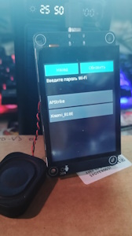
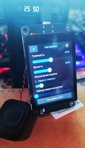
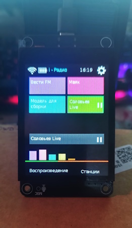

# Моё интернет-радио на ESP32-S3

**Автор и разработчик: Борисенко Д.А.**  
г. Краснодон, ЛНР, 2026 год.

Я разрабатываю интернет-радио с сенсорным управлением на плате **LCDWiki ES3C28P**. Радиостанции воспроизводятся через Wi-Fi, а экран позволяет выбирать станции, управлять громкостью и менять настройки без компьютера.

## Содержание

- [Возможности](#возможности)
- [Оборудование](#оборудование)
- [Библиотеки и зависимости](#библиотеки-и-зависимости)
- [Файлы программы](#файлы-программы)
- [Управление](#управление)
- [Список станций](#список-станций)
- [Особенности реализации](#особенности-реализации)
- [Ограничения и безопасность](#ограничения-и-безопасность)

## Возможности

- Прослушивание интернет-радиостанций из моего списка.
- Сенсорный интерфейс в стиле Metro и поддержка кириллицы.
- Четыре сохраняемые станции в избранном.
- Регулировка и сохранение громкости.
- Сохранение последней станции и настроек.
- Подключение к сохранённой сети Wi-Fi и запуск настройки сети из интерфейса.
- Регулировка яркости от 15 до 100 %.
- Сон дисплея без остановки радио; пробуждение касанием без случайного нажатия кнопки.
- Таймер остановки радио на текущий сеанс: 15, 30, 60 или 90 минут.
- Часы московского времени (UTC+3); до синхронизации показываю `--:--`.
- Индикатор Wi-Fi и приблизительный индикатор заряда батареи.
- Окно информации об авторе.

## Оборудование

| Узел | Что использую |
|---|---|
| Основная плата | LCDWiki ES3C28P на ESP32-S3 |
| Дисплей | Встроенный ILI9341V, 240 × 320 пикселей |
| Сенсор | Встроенный FT6336G |
| Аудиокодек | Встроенный ES8311 |
| Усилитель динамика | Встроенный FM8002E |
| Динамик | Пассивный, 8 Ом, подключённый к выходу SPK |
| Питание | USB, 5 В, исправный кабель и стабильный источник |
| Сеть | Wi-Fi 2,4 ГГц с доступом в интернет |
| Память | Требуется работающая PSRAM для интерфейса и аудио |

Это программа для конкретной платы, а не универсальная прошивка для любых ESP32-S3. На другой плате могут отличаться экран, сенсор, аудиотракт и распиновка.

### Используемые соединения встроенных узлов

| Узел | GPIO |
|---|---|
| Дисплей: MOSI / MISO / SCLK | 11 / 13 / 12 |
| Дисплей: CS / DC / подсветка | 10 / 46 / 45 |
| I²C: SDA / SCL | 16 / 15 |
| Сенсор: Reset / Interrupt | 18 / 17 |
| Аудио: MCLK / BCLK / LRCK | 4 / 5 / 7 |
| Аудио: DOUT / DIN | 6 / 8 |
| Управление усилителем | 1 |

Эти соединения уже выполнены на плате. Дополнительные провода к встроенному дисплею, сенсору и кодеку не требуются.

## Библиотеки и зависимости

Я сохраняю версии из `platformio.ini`: обновление библиотеки может изменить её интерфейс или поведение программы.

| Библиотека | Версия / ревизия | Назначение |
|---|---|---|
| [LovyanGFX](https://github.com/lovyan03/LovyanGFX) | **1.3.0**, автор `lovyan03` | Управление дисплеем и передача изображения |
| [LVGL](https://github.com/lvgl/lvgl) | **9.6.0** | Экраны, плитки, надписи, кнопки, ползунки и обработка интерфейса |
| [ESP32-audioI2S](https://github.com/schreibfaul1/ESP32-audioI2S) | Коммит **`2ef8cf7f0bee5ec2704752db9560ccfb41d54052`** | Получение и декодирование аудиопотока, вывод звука по I²S |
| [WiFiManager](https://github.com/tzapu/WiFiManager) | **2.0.17**, автор `tzapu` | Настройка подключения к Wi-Fi |

Для ESP32-audioI2S закреплён именно коммит, а не номер релиза. Произвольная последняя версия не является точной заменой.

### Зависимости платформы

`Arduino.h`, `Wire`, `WiFi`, `Preferences` и `LittleFS` входят в Arduino framework для ESP32. Отдельные сторонние библиотеки с такими же именами устанавливать не нужно.

- **Wire** — обмен по I²C с сенсором и аудиокодеком.
- **WiFi** — подключение к беспроводной сети.
- **Preferences** — сохранение настроек в энергонезависимой памяти.
- **LittleFS** — работа с файловой системой во внутренней flash-памяти.
- **FreeRTOS** — задачи, очереди и синхронизация.
- **ESP-IDF** (`esp_heap_caps`, `esp_system`, `esp_log`) — управление памятью и системные функции ESP32.
- Стандартные заголовки `atomic`, `math.h`, `time.h` — обмен состояниями между задачами, вычисления и время.

При переносе исходников в другую среду, в том числе Arduino IDE, необходимы перечисленные версии библиотек, поддержка ESP32-S3, PSRAM и та же конфигурация LVGL. Один только файл `main.cpp` не содержит всего проекта. Инструкции установки другой среды здесь не привожу: в Schematik зависимости устанавливаются по `platformio.ini`, а сборка и прошивка выполняются кнопкой **Deploy**.

## Файлы программы

| Файл | Назначение |
|---|---|
| `src/main.cpp` | Основная программа: оборудование, аудио, интерфейс, сеть и настройки |
| `include/audio_pinout.h` | Подбор совместимой сигнатуры настройки аудиовыводов при компиляции |
| `include/lv_conf.h` | Конфигурация LVGL, формат цвета и настройки памяти |
| `include/stations.h` | Мой список названий и адресов радиостанций |
| `src/dejavu_16.c` | Рабочий шрифт с кириллицей; сохраняю его без изменений |
| `platformio.ini` | Framework и закреплённые зависимости |
| `board.yaml` | Описание платы и параметров сборки |
| `parts.yaml`, `wiring.yaml` | Динамик и его соединения |
| `assembly.yaml`, `power.yaml` | Сборка и питание |
| `include/readme.md` | Этот документ |

Для приложения используется таблица разделов `huge_app.csv`. Настройки памяти и LVGL должны оставаться согласованными с кодом.

## Управление

### Первый запуск

1. Подключаю динамик к SPK и подаю питание через USB.
2. Настраиваю Wi-Fi через предусмотренное программой окно настройки сети.
3. Выбираю станцию и устанавливаю удобную громкость.

После сохранения настроек программа использует сохранённую сеть, громкость и последнюю станцию.

### Станции и избранное

Кнопка **«Станции»** открывает список. Нажатие на название или значок запуска выбирает станцию. Чекбокс только добавляет или удаляет её из избранного: не запускает воспроизведение и не закрывает список.

В избранном сохраняю не более четырёх станций. На плитке проигрываемой станции показываю Pause; при паузе значок исчезает.

### Настройки

Громкость располагается над яркостью. Выбранный уровень громкости сохраняю и повторно применяю после переключения станции. Разные станции могут иметь разный исходный уровень записи.

Сон дисплея и таймер остановки радио — разные функции: сон выключает подсветку, но оставляет звук; таймер останавливает воспроизведение. Значок информации открывает сведения об авторе, не останавливая радио.

## Список станций

Список храню в `include/stations.h`. Для добавления или изменения станции редактирую название и URL в существующем формате массива. Не меняю структуру данных и служебные определения без необходимости.

Адрес должен вести к совместимому аудиопотоку, а не просто к странице сайта. Доступность потока зависит от станции и сети. После изменения списка пересобираю и прошиваю программу. Если меняю порядок или состав списка, проверяю последнюю станцию и избранное: сохранённые позиции могут потребовать повторного выбора.

## Особенности реализации

Я разделяю обработку звука и интерфейса между задачами. Состояния передаю через предусмотренные очереди, синхронизацию и атомарные переменные. Это позволяет сохранять отзывчивость управления во время воспроизведения.

Для LVGL использую RGB565 и пул памяти размером 512 КиБ с размещением в PSRAM. Объекты интерфейса требуют достаточно памяти; несогласованная конфигурация может привести к нехватке памяти и исчезновению элементов экрана.

Сохраняю проверенный шрифт и чёткие пиксельные значки. Не заменяю рабочую аудионастройку альтернативными вариантами без необходимости. Сообщение о запуске потока само по себе не доказывает наличие слышимого звука — результат проверяю динамиком.

## Ограничения и безопасность

- FM8002E — усилитель мощности динамика, а не отдельный звуковой процессор.
- Выход SPK мостовой: **ни один контакт динамика не соединяю с GND**.
- Выходы динамика не подключаю напрямую к AUX или RCA.
- Прямой тестовый тон через отдельный низкоуровневый аудиодрайвер не использую: он конфликтовал с рабочим аудиотрактом.
- Индикатор батареи приблизительный. Измерение через GPIO9 ещё требует проверки с реальным аккумулятором; неопределённое измерение обозначаю `?`.
- Состояния USB и зарядки по одному напряжению батареи не определяю. Дополнительных проводов для индикатора не требуется.
- Перед подключением аккумулятора проверяю совместимость и полярность разъёма. Первую зарядку провожу под присмотром; корпус не должен давить на аккумулятор или иметь острые края рядом с ним.
- Стабильность интернет-радио зависит также от Wi-Fi, сервера станции и формата потока.

---

Этот README находится в папке `include`. Для отображения документа на главной странице репозитория GitHub могу дополнительно поместить его копию с именем `README.md` в корень репозитория.

## Веб-пульт — реализован

После подключения радио к Wi-Fi открываю настройки и окно ⓘ: 
там показан адрес `http://адрес-платы:8080`. 
Телефон или компьютер подключаю к той же сети. 
Страница на русском хранится в прошивке, интернет для её загрузки не требуется. На первом этапе доступны статус, станции, пуск/пауза, остановка и громкость. Громкость сохраняется существующим механизмом и согласуется с экраном.

HTTP работает в отдельной задаче ESP-IDF; новых библиотек не добавляю. Порт 8080 не конфликтует с портом 80 настройки Wi-Fi. Пульт без пароля: пользуюсь только доверенной домашней сетью и не пробрасываю порт в интернет. Любой участник этой сети может управлять радио. Проверку непрерывного звука и управления при неисправном потоке выполняю на устройстве. Избранное и остальные настройки добавлю вторым этапом после проверки первого.
